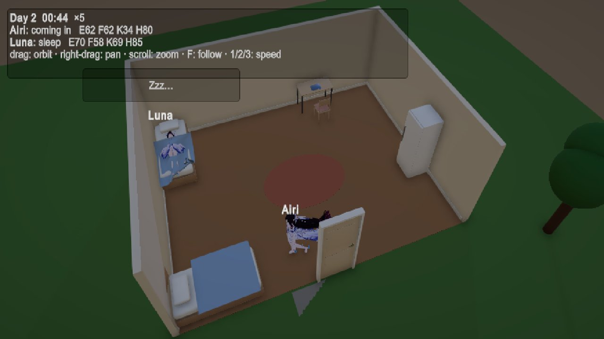
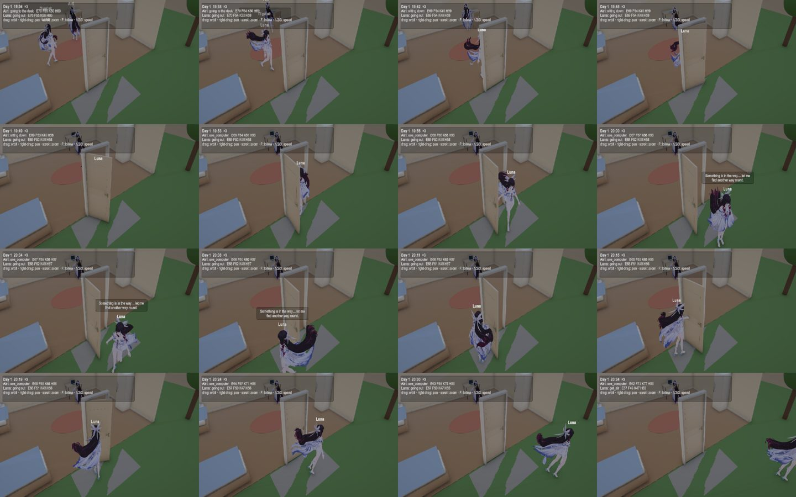
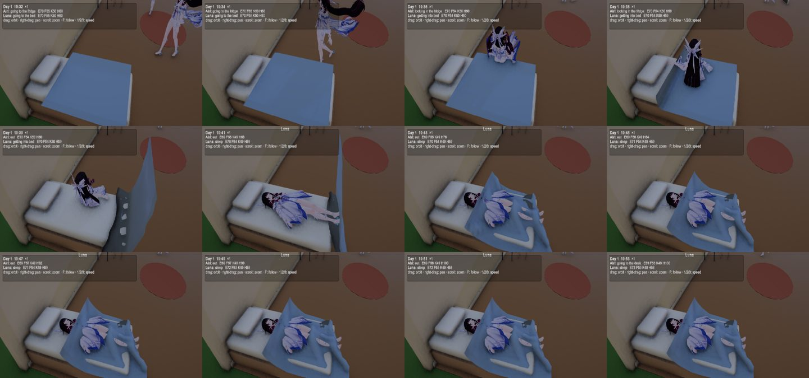
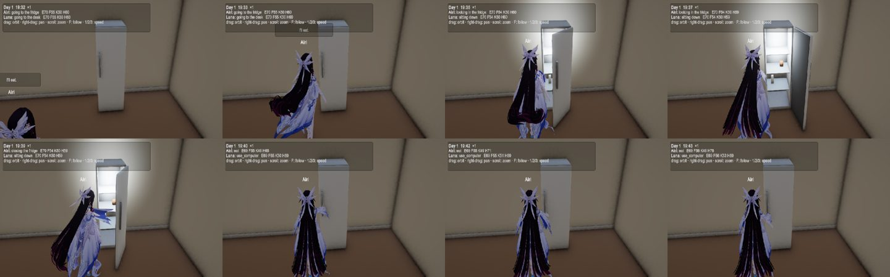
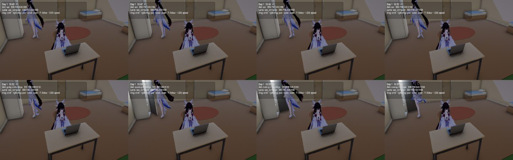

# AI World (airi-v3d-game)

**English** | [简体中文](README.zh-CN.md)

A small 3D world driven entirely by AI. Think "VRChat, but the inhabitants are AIs": each AI has a VRM avatar, lives in a shared house, follows its own daily routine (sleeps, uses the computer, eats, goes out for fresh air), and uses the things in the house the way a person would.

Built with **Unity 6** (URP), [UniVRM](https://github.com/vrm-c/UniVRM), Unity's NavMesh and its physics.

> **Status: Unity migration, milestone 1 (vertical slice).** The game moved from three.js to Unity because the web version could not get past its limits: props that do not come apart, stiff procedural motion, and doors without weight. This branch has one house with a working door, bed, desk and fridge, two characters, and the rule-based mock brain. The LLM brain, memory, small talk, speech and the AIRI bridge from the web version are **not ported yet**; they are in git history (the last web version is commit `157b50f`).



| Door (R3) | Bed (R2) |
| --- | --- |
|  |  |
| **Fridge** | **Desk** |
|  |  |

## What is new in Unity

- **Props that come apart.** The fridge door, the laptop lid and the front door are separate parts on hinges, and the blanket is cloth. Every moving part is a rigid body on a `HingeJoint` with a spring and a damper, so it has weight: it speeds up, slows down and settles, and stops against people instead of passing through them. Characters push it by the handle; they never set its angle.
- **Humanoid animation.** Every pose is an Animator state, and every change of pose is a cross-fade. Hands are placed on handles and lids with arm IK, the head and eyes turn to what the character attends to, and the hips are lowered onto seats and mattresses whatever the avatar's size. VRM spring bones move the hair.
- **NavMesh walking** with avoidance between the characters; the door and fridge door carve the NavMesh where they stand.
- **Smooth, bevelled props** modelled in Blender from a script ([`tools/blender/build_props.py`](tools/blender/build_props.py)), instead of the low-poly kit.
- **A generated scene.** [`SliceSceneBuilder.cs`](Assets/Scripts/Editor/SliceSceneBuilder.cs) builds `Assets/Scenes/Room.unity` from code (house, props, joints, cloth, NavMesh, lighting, characters), so the scene can be reviewed and rebuilt.

The behaviour rules from the web version carry over: see [`Assets/Scripts/Agents/RULES.md`](Assets/Scripts/Agents/RULES.md).

## Quick start

Requires **Unity 6000.6.9f1** (with the Mac or Windows build support you need) and Blender 4+ only if you change the props.

1. Open the project in Unity Hub (the repository root is the project), or from the command line:
   ```bash
   unity open .
   ```
   The first import downloads UniVRM from GitHub and takes a few minutes.
2. Open `Assets/Scenes/Room.unity` and press Play.

If the avatars show pink or missing after the first import, run **AiWorld ▸ Build Room Scene**: it imports the models again (the first import of a fresh checkout runs before the VRM shaders exist) and rebuilds the scene. From the command line:

```bash
/Applications/Unity/Hub/Editor/6000.6.9f1/Unity.app/Contents/MacOS/Unity -batchmode -projectPath . -executeMethod AiWorld.EditorTools.BatchTools.BuildScene -quit
```

### Your own avatars

Put your models at `Assets/Avatars/User/model.vrm` (Airi) and `Assets/Avatars/User/model2.vrm` (Luna), then run **AiWorld ▸ Build Room Scene**. Any VRM 0.x or 1.0 works. These files are git-ignored. Without them the game uses two public sample avatars in [`Assets/Avatars`](Assets/Avatars) (Seed-san by VirtualCast, Inc. and VRM1_Constraint_Twist_Sample by pixiv Inc., VRM Public License 1.0).

## Controls

| Input | Action |
| --- | --- |
| Drag | Rotate the camera |
| Right-drag | Pan |
| Scroll | Zoom |
| `F` | Follow Airi → Luna → free. Moving the camera by hand ends it. |
| `R` | Reset the view |
| `1` / `2` / `3` | Game speed (×1 / ×5 / ×20) |

Walls between the camera and the room hide themselves (they still cast shadows).

## Project layout

| Path | What is there |
| --- | --- |
| `Assets/Scripts/Agents` | `Agent` (needs, the day loop, and the routines that do each action), `AvatarRig` (the body: Animator, IK, look-at, blinking, body colliders), `MockBrain` (picks what to do next; an LLM brain plugs into `IBrain`) |
| `Assets/Scripts/World` | `Hinged` (doors and lids), `SoftBlanket` (the cloth quilt, turned back on a hinge), `QuiltShell` (draws the cloth as a thick quilted duvet), `Interactable` and `Affordance` (what a thing lets you do), `House` (inside or outside, the front door), `GameClock`, `WallCutaway`, and the `*Parts` components that hold the points a routine needs |
| `Assets/Scripts/Editor` | `SliceSceneBuilder` (builds the scene), `ClipFactory` (makes the humanoid clips and the Animator Controller), `BatchTools` (command-line entry points) |
| `Assets/Art/Props` | The props, exported by `tools/blender/build_props.py` |
| `Assets/Animations` | `Character.controller`; `Generated/` holds the made clips; put motion capture in `Mocap/` |
| `bridge/` | The AIRI MCP bridge from the web version (Node). It still speaks the web page's protocol; the Unity side is not written yet. |
| `art/` | Blender sources and the Kenney furniture kit used by the web version |
| `tools/kimodo` | Scripts that make motion clips with NVIDIA's Kimodo (`.vrma`) |

### Motion capture

The clips in `Assets/Animations/Generated` (idle, walk, sit, type, lie, eat, and the in-between poses for getting into and out of bed) are made from humanoid muscle values by `ClipFactory`. They play on any VRM, but they are placeholders. **Real motion capture is the biggest step up in quality:** put a humanoid clip named `Idle`, `Walk`, `Sit`, `Type`, `Lie` or `Eat` (an `.fbx` with its rig set to Humanoid, or an `.anim`) in `Assets/Animations/Mocap`, then run **AiWorld ▸ Build Animator**. Mixamo (free with an Adobe account) and the Unity Asset Store have suitable clips.

### Props

Edit `tools/blender/build_props.py`, then:

```bash
/Applications/Blender.app/Contents/MacOS/Blender -b --factory-startup -P tools/blender/build_props.py -- --repo .
```

A part named `<Prop>.Hinge.<Part>` swings on a hinge at its origin (about the vertical axis, or the left-right axis if the name ends in `.X`); `<Prop>.Soft.<Part>` becomes cloth. Then run **AiWorld ▸ Build Room Scene**.

## Not ported yet

From the web version (see git history up to `157b50f`):

- the LLM brain (OpenAI-compatible endpoint), memory and reflection, small talk and chance meetings, speech bubbles and text-to-speech, gestures and facial expressions on request;
- the AIRI connection: `bridge/airi-mcp.mjs` is kept, and `Agent.Request(objectId, verb)` is the hook a Unity-side WebSocket client will call;
- R1 (shoes off before bed), the outdoor area with the lake and the rowboat, the tent;
- a Web (WebGL) build and the GitHub Pages demo.

## Known limitations

- Generated clips are stiff compared with motion capture (see above).
- The blanket collides with capsules round the body, not with the clothes: very wide sleeves or skirts can show through it.
- CI checks only the Node bridge: building the Unity project in CI needs a Unity license set up as a secret.

## Inspiration

- [Project AIRI](https://github.com/moeru-ai/airi) for the idea of a self-driven AI companion.
- *Generative Agents: Interactive Simulacra of Human Behavior* (Park et al., 2023) for the memory / reflection design.
- *The Sims* for affordance-based objects.
