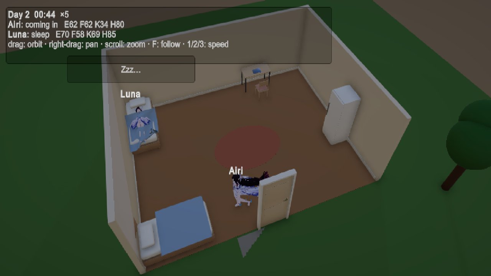
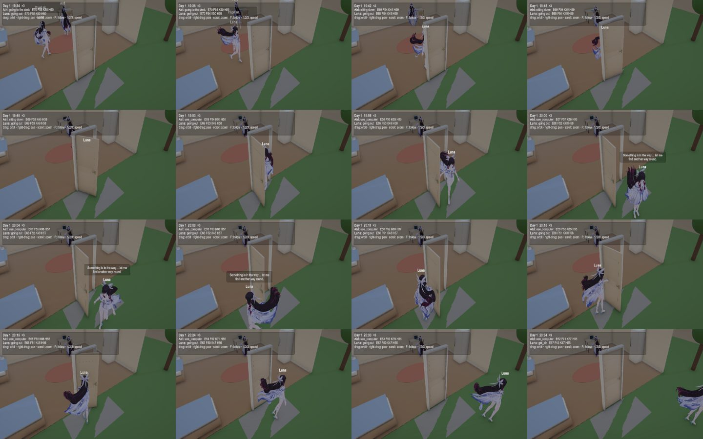
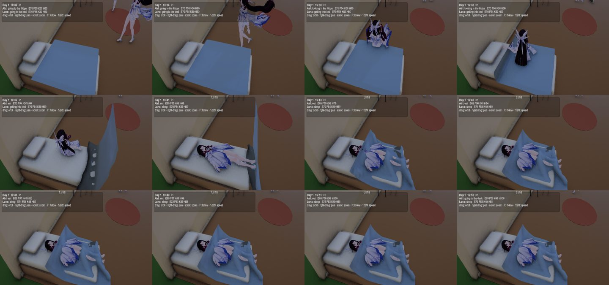
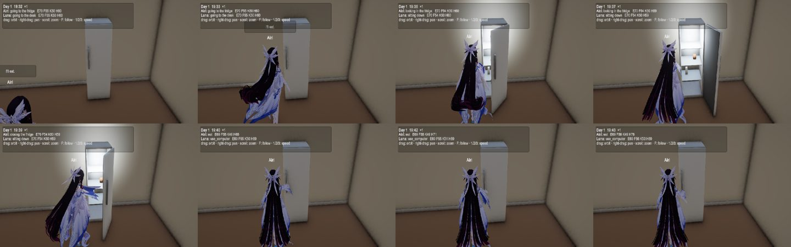
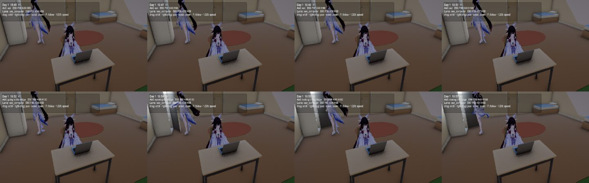

# AI World（airi-v3d-game）

[English](README.md) | **简体中文**

一个完全由 AI 驱动的小型 3D 世界。可以把它理解成「VRChat，但里面的居民是 AI」：每个 AI 都有自己的 VRM 形象，住在同一栋房子里，有自己的生活规律（睡觉、用电脑、吃东西、出门透气），并像人一样使用房子里的东西。

使用 **Unity 6**（URP）、[UniVRM](https://github.com/vrm-c/UniVRM)、Unity 的 NavMesh 和物理引擎构建。

> **当前状态：正在迁移到 Unity，第一阶段（垂直切片）。** 游戏从 three.js 改为 Unity，因为网页版已经碰到了瓶颈：物品无法拆开、程序化动作僵硬、开门关门没有重量感。这个分支有一栋房子，其中的门、床、书桌和冰箱都能真正使用，有两个角色和规则型的模拟大脑。网页版的 LLM 大脑、记忆、闲聊、语音和 AIRI 桥接**还没有移植**，它们都保留在 git 历史里（网页版最后一次提交是 `157b50f`）。



| 开门（R3） | 上床（R2） |
| --- | --- |
|  |  |
| **冰箱** | **书桌** |
|  |  |

## Unity 版本的新东西

- **可以拆开的物品。** 冰箱门、笔记本电脑的屏幕、大门都是独立的部件，装在铰链上；被子是布料。每个会动的部件都是装在 `HingeJoint` 上、带弹簧和阻尼的刚体，所以有重量：会加速、减速、停稳，碰到人会停下而不是穿过去。角色通过把手去推它，从不直接设定角度。
- **人形动画。** 每个姿势都是 Animator 的一个状态，姿势之间都有过渡混合。手通过手臂 IK 放到把手和屏幕上，头和眼睛会看向角色注意的东西，不论模型多高，臀部都会落在座位和床垫上。头发由 VRM 弹簧骨骼驱动。
- **NavMesh 寻路**，角色之间会互相避让；门和冰箱门停下时会在 NavMesh 上挖出自己占的位置。
- **圆润带倒角的物品**，由 Blender 脚本建模（[`tools/blender/build_props.py`](tools/blender/build_props.py)），不再使用低多边形素材包。
- **由代码生成的场景。** [`SliceSceneBuilder.cs`](Assets/Scripts/Editor/SliceSceneBuilder.cs) 用代码生成 `Assets/Scenes/Room.unity`（房子、物品、铰链、布料、NavMesh、灯光、角色），所以场景可以审阅、可以重建。

网页版的行为规则继续有效：见 [`Assets/Scripts/Agents/RULES.md`](Assets/Scripts/Agents/RULES.md)。

## 快速开始

需要 **Unity 6000.6.9f1**（以及你需要的 Mac 或 Windows 构建支持）。只有修改物品时才需要 Blender 4 以上版本。

1. 在 Unity Hub 里打开项目（仓库根目录就是项目），或者用命令行：
   ```bash
   unity open .
   ```
   第一次导入会从 GitHub 下载 UniVRM，需要几分钟。
2. 打开 `Assets/Scenes/Room.unity`，按 Play。

如果第一次导入后角色显示为粉色或不见了，运行 **AiWorld ▸ Build Room Scene**：它会重新导入模型（新检出的项目第一次导入时 VRM 着色器还不存在）并重建场景。命令行：

```bash
/Applications/Unity/Hub/Editor/6000.6.9f1/Unity.app/Contents/MacOS/Unity -batchmode -projectPath . -executeMethod AiWorld.EditorTools.BatchTools.BuildScene -quit
```

### 使用自己的形象

把模型放到 `Assets/Avatars/User/model.vrm`（Airi）和 `Assets/Avatars/User/model2.vrm`（Luna），然后运行 **AiWorld ▸ Build Room Scene**。VRM 0.x 和 1.0 都可以。这两个文件不会提交到 git。没有它们时，游戏使用 [`Assets/Avatars`](Assets/Avatars) 里的两个公开示例形象（VirtualCast, Inc. 的 Seed-san 和 pixiv Inc. 的 VRM1_Constraint_Twist_Sample，VRM Public License 1.0）。

## 操作

| 输入 | 作用 |
| --- | --- |
| 拖动 | 旋转镜头 |
| 右键拖动 | 平移 |
| 滚轮 | 缩放 |
| `F` | 跟随 Airi → Luna → 自由视角。手动移动镜头会退出跟随。 |
| `R` | 重置视角 |
| `1` / `2` / `3` | 游戏速度（×1 / ×5 / ×20） |

挡在镜头和房间之间的墙会自动隐藏（影子仍然保留）。

## 项目结构

| 路径 | 内容 |
| --- | --- |
| `Assets/Scripts/Agents` | `Agent`（需求、一天的循环，以及完成每个动作的流程）、`AvatarRig`（身体：Animator、IK、注视、眨眼、身体碰撞体）、`MockBrain`（决定接下来做什么；LLM 大脑通过 `IBrain` 接入） |
| `Assets/Scripts/World` | `Hinged`（门和盖子）、`SoftBlanket`（布料被子）、`Interactable` 和 `Affordance`（物品能做什么）、`House`（屋内或屋外、大门）、`GameClock`、`WallCutaway`，以及保存动作所需位置点的各个 `*Parts` 组件 |
| `Assets/Scripts/Editor` | `SliceSceneBuilder`（生成场景）、`ClipFactory`（生成人形动画片段和 Animator Controller）、`BatchTools`（命令行入口） |
| `Assets/Art/Props` | 物品模型，由 `tools/blender/build_props.py` 导出 |
| `Assets/Animations` | `Character.controller`；`Generated/` 里是生成的动画片段；动作捕捉放进 `Mocap/` |
| `bridge/` | 网页版的 AIRI MCP 桥接（Node）。它仍然使用网页版的协议，Unity 端还没写。 |
| `art/` | Blender 源文件，以及网页版使用的 Kenney 家具素材包 |
| `tools/kimodo` | 用 NVIDIA Kimodo 生成动作片段（`.vrma`）的脚本 |

### 动作捕捉

`Assets/Animations/Generated` 里的动画片段（站立、走路、坐、打字、躺、吃东西）由 `ClipFactory` 根据人形肌肉数值生成。它们适用于任何 VRM，但只是占位用的。**真正的动作捕捉是画质提升最大的一步：** 把名为 `Idle`、`Walk`、`Sit`、`Type`、`Lie` 或 `Eat` 的人形动画片段（骨骼设为 Humanoid 的 `.fbx`，或 `.anim`）放进 `Assets/Animations/Mocap`，然后运行 **AiWorld ▸ Build Animator**。Mixamo（有 Adobe 账号即可免费使用）和 Unity Asset Store 上都有合适的片段。

### 物品

修改 `tools/blender/build_props.py`，然后运行：

```bash
/Applications/Blender.app/Contents/MacOS/Blender -b --factory-startup -P tools/blender/build_props.py -- --repo .
```

名为 `<物品>.Hinge.<部件>` 的部件会绕它的原点转动（默认绕竖直轴，名字以 `.X` 结尾时绕左右轴）；`<物品>.Soft.<部件>` 会变成布料。然后运行 **AiWorld ▸ Build Room Scene**。

## 还没有移植的部分

来自网页版（见 git 历史，截至 `157b50f`）：

- LLM 大脑（兼容 OpenAI 接口）、记忆与反思、闲聊与偶遇、对话气泡与语音、按需做出的手势和表情；
- AIRI 连接：`bridge/airi-mcp.mjs` 已保留，`Agent.Request(objectId, verb)` 是将来 Unity 端 WebSocket 客户端要调用的入口；
- R1（上床前脱鞋）、有湖和小船的户外区域、帐篷；
- Web（WebGL）构建和 GitHub Pages 在线演示。

## 已知限制

- 生成的动画片段比动作捕捉僵硬（见上文）。
- 角色是侧着滑到书桌椅子上的，椅子还不会动。
- 被子只和胶囊体做碰撞：脚可能会穿出来，被子也可能堆到一边。
- CI 只检查 Node 桥接：在 CI 里构建 Unity 项目需要把 Unity 许可证配置为密钥。

## 灵感来源

- [Project AIRI](https://github.com/moeru-ai/airi)：自主 AI 伙伴的想法。
- 《Generative Agents: Interactive Simulacra of Human Behavior》（Park 等，2023）：记忆与反思的设计。
- 《模拟人生》：基于可供性的物品设计。
